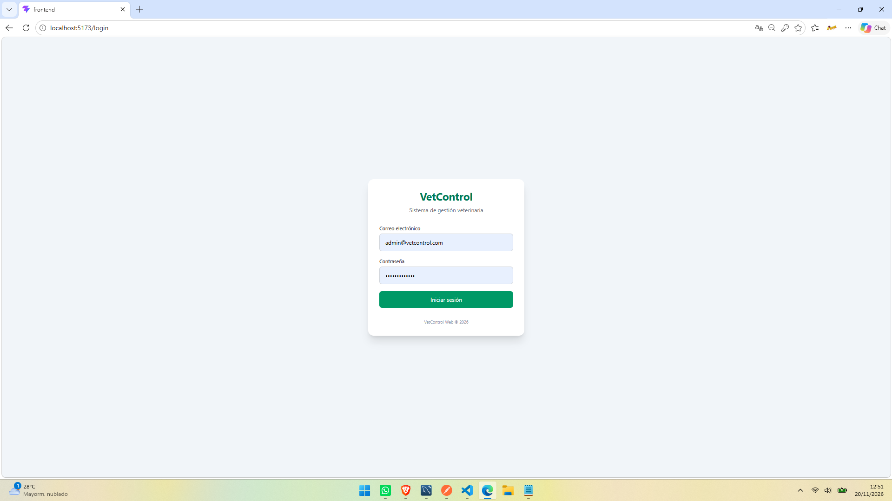
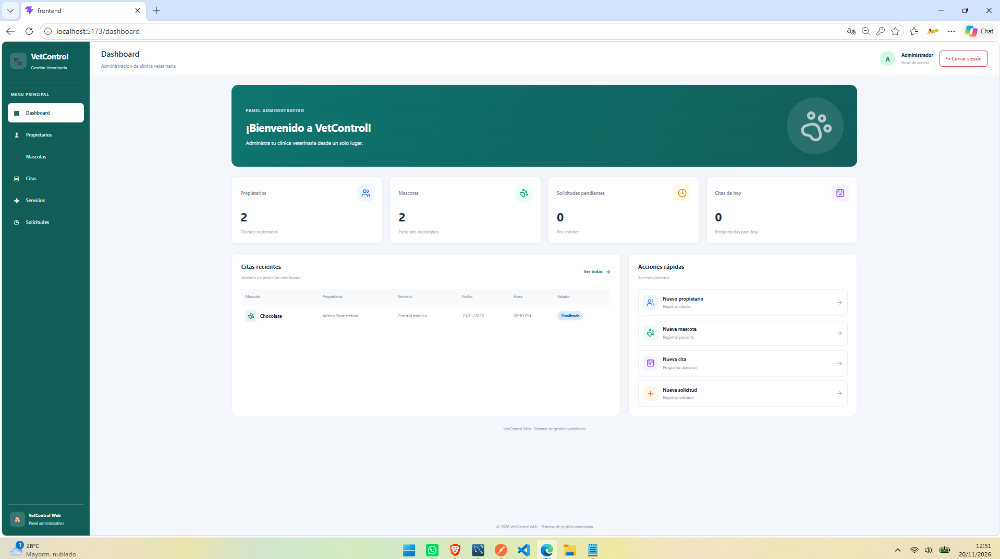
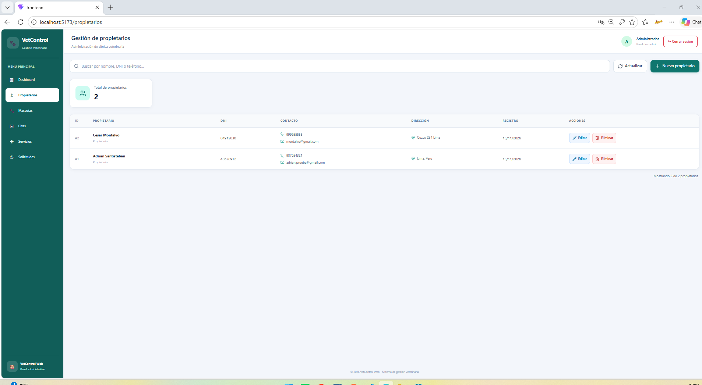
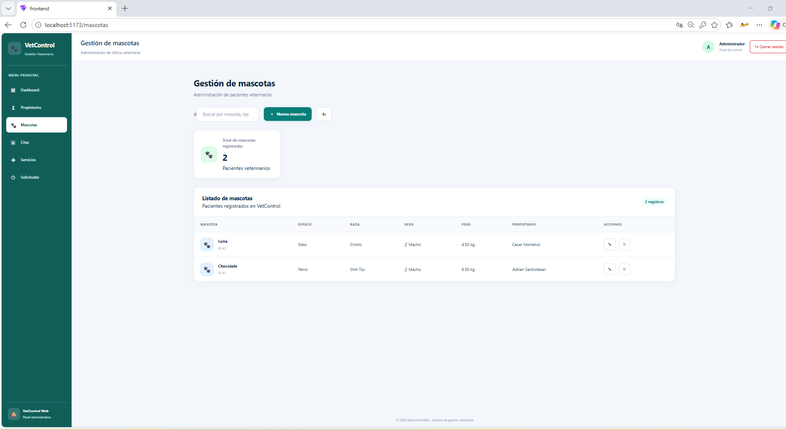
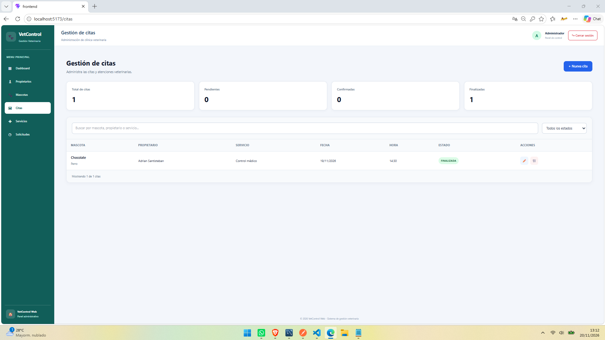
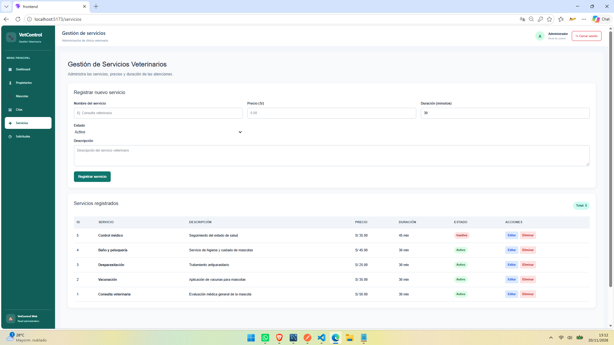
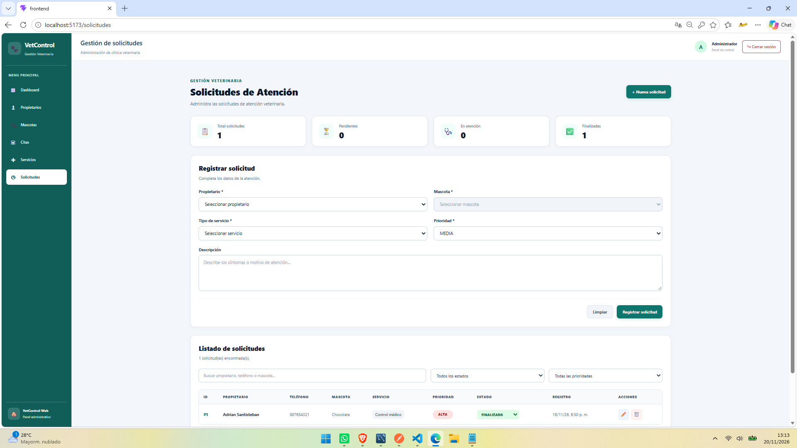

# VetControlWeb

Sistema web de gestión veterinaria desarrollado para organizar y centralizar las operaciones de una clínica veterinaria mediante una aplicación web.

## Descripción del proyecto

**VetControlWeb** permite gestionar la información de propietarios, mascotas, citas, servicios veterinarios y solicitudes de atención desde una plataforma centralizada.

El sistema cuenta con una arquitectura cliente-servidor: un frontend desarrollado con React y TypeScript, y un backend desarrollado con Node.js y Express, conectado a una base de datos MySQL.

## Objetivo general

Desarrollar un sistema web que facilite la administración de las actividades de una clínica veterinaria, mejorando la organización de la información y el seguimiento de las solicitudes de atención.

## Tecnologías utilizadas

### Frontend
- React 19
- TypeScript
- Vite
- React Router DOM
- Axios
- Tailwind CSS
- Lucide React

### Backend
- Node.js
- Express 5
- JavaScript
- MySQL2
- JSON Web Token (JWT)
- BcryptJS
- CORS
- Dotenv

### Base de datos
- MySQL

## Módulos del sistema

| Módulo | Funcionalidad |
|---|---|
| Dashboard | Visualización de indicadores generales |
| Propietarios | Gestión de información de propietarios |
| Mascotas | Registro y administración de mascotas |
| Citas | Gestión de citas veterinarias |
| Servicios | Administración de servicios y precios |
| Solicitudes | Registro y seguimiento de solicitudes de atención |
| Autenticación | Inicio de sesión y protección de rutas mediante JWT |

## Arquitectura del proyecto

El proyecto utiliza una arquitectura cliente-servidor:

- **Frontend:** presenta la interfaz y permite la interacción con el usuario.
- **Backend:** procesa las solicitudes HTTP y aplica las reglas de negocio.
- **API REST:** conecta el frontend con el backend.
- **MySQL:** almacena la información del sistema.
- **JWT:** permite autenticar las solicitudes protegidas.

## Seguridad y control de acceso (RBAC)

El backend implementa autenticación mediante JSON Web Token (JWT) y autorización basada en roles (RBAC). El middleware de autenticación valida el token y el middleware de autorización comprueba si el rol tiene permiso para ejecutar la operación solicitada.

## Matriz de permisos y accesos (RBAC)

La siguiente matriz muestra los permisos asignados a cada rol dentro del sistema VetControlWeb.

| Módulo | ADMIN | RECEPCIONISTA |
|---|---|---|
| Dashboard | Consultar | Consultar |
| Propietarios | Consultar, registrar, actualizar y eliminar | Consultar, registrar y actualizar |
| Mascotas | Consultar, registrar, actualizar y eliminar | Consultar, registrar y actualizar |
| Citas | Consultar, registrar, actualizar y eliminar | Consultar, registrar y actualizar |
| Servicios | Consultar, registrar, actualizar y eliminar | Solo consultar |
| Solicitudes | Consultar, registrar, actualizar y eliminar | Consultar, registrar y actualizar |

### Consideraciones
- **ADMIN:** Tiene acceso completo a todos los módulos y operaciones del sistema.
- **RECEPCIONISTA:** Puede consultar, registrar y actualizar información, pero no puede eliminar registros.
- **Servicios:** El RECEPCIONISTA únicamente tiene permiso de consulta.

## Reglas de autorización y control de acceso (RBAC)

El sistema VetControlWeb implementa un mecanismo de autorización basado en roles (RBAC), que permite controlar el acceso a los módulos y operaciones según los permisos asignados a cada usuario.

## Reglas de autorización:

- **Autenticación JWT:** Las rutas protegidas requieren un token JWT válido para permitir el acceso.

- **Consultas:** Las operaciones de consulta de los módulos requieren autenticación.

- **Propietarios, Mascotas, Citas y Solicitudes:** Los roles ADMIN y RECEPCIONISTA pueden consultar, registrar y actualizar información.

- **Eliminación de registros:** Únicamente el rol ADMIN puede eliminar propietarios, mascotas, citas y solicitudes.

- **Gestión de Servicios:** Las operaciones de registro, actualización y eliminación están reservadas exclusivamente al rol ADMIN. El RECEPCIONISTA solo puede consultar los servicios.

- **Dashboard:** El acceso al panel de estadísticas está permitido a los roles ADMIN y RECEPCIONISTA.

- **Registro de usuarios:** La creación de nuevas cuentas está restringida exclusivamente al rol ADMIN.

**Objetivo:** Garantizar que cada usuario acceda únicamente a las funcionalidades autorizadas según su rol, protegiendo la integridad y seguridad de la información del sistema.
## Estructura del repositorio

```text
VetControlWeb/
│
├── backend/
│   ├── src/
│   │   ├── controllers/
│   │   ├── middleware/
│   │   ├── routes/
│   │   ├── config/
│   │   └── server.js
│   │
│   ├── .env
│   ├── .gitignore
│   └── package.json
│
├── frontend/
│   ├── public/
│   ├── src/
│   │   ├── components/
│   │   ├── layouts/
│   │   ├── pages/
│   │   └── styles/
│   │
│   └── package.json
│
└── .gitignore
```

## Requisitos previos

Para ejecutar el proyecto localmente se requiere:

- Node.js y npm.
- MySQL Server.
- Visual Studio Code u otro editor.
- Git.

## Instalación y ejecución

### 1. Clonar el repositorio

```bash
git clone https://github.com/santiman0408-sudo/VetControlWeb.git
cd VetControlWeb
```

### 2. Configurar el backend

Ingresar a la carpeta:

```bash
cd backend
npm install
```

## Crear el archivo .env utilizando la plantilla .env.example.

## En PowerShell, ejecutar:

Copy-Item .env.example .env

## Abrir el archivo .env y configurar los valores correspondientes al entorno local:

PORT=4000
NODE_ENV=development

DB_HOST=127.0.0.1
DB_PORT=3307
DB_USER=root
DB_PASSWORD=TU_PASSWORD_MYSQL
DB_DATABASE=vetcontrol_web

FRONTEND_URL=http://localhost:5173

JWT_SECRET=REEMPLAZAR_POR_UN_SECRETO_SEGURO
JWT_EXPIRES_IN=8h

- **Importante:** reemplazar los valores de ejemplo por la configuración local. No publicar contraseñas ni secretos reales. El archivo .env está excluido del repositorio mediante .gitignore.

## Iniciar el backend:

```bash
npm run dev
```

## El servidor estará disponible en:

- API: `http://localhost:4000/api`
- Estado: `http://localhost:4000/api/health`

### 3. Configurar el frontend

Abrir otra terminal y ejecutar:

```bash
cd frontend
npm install
npm run dev
```

## Abrir la aplicación en:

`http://localhost:5173`

### 4. Compilar el frontend

## Para comprobar la compilación de producción:

```bash
cd frontend
npm run build
```

## Endpoints principales de la API

| Recurso | Endpoint |
|---|---|
| Autenticación | `/api/auth` |
| Dashboard | `/api/dashboard/estadisticas` |
| Propietarios | `/api/propietarios` |
| Mascotas | `/api/mascotas` |
| Citas | `/api/citas` |
| Servicios | `/api/servicios` |
| Solicitudes | `/api/solicitudes` |
| Estado del servidor | `/api/health` |

Las rutas de gestión requieren autenticación mediante token JWT, según la protección configurada en el backend.

## Seguridad

- Autenticación mediante JSON Web Token.
- Contraseñas protegidas mediante BcryptJS.
- Protección de rutas mediante middleware.
- Control de acceso según roles.
- Variables sensibles almacenadas en archivos `.env`.
- Archivos de entorno excluidos mediante `.gitignore`.

## Integrantes
  
- Siri Vergara, Maria Alejandra  
- Villasante Contreras, Jean Paul 
- Valdiviezo Atero, Yoli Jhunior 
- Santisteban Manrique, Adrian Daniel 
- Ramirez del Aguila, Angello Andre

## Curso: 

Gestión de Proyectos Ágiles

## Estado del proyecto

Proyecto publicado en GitHub y en desarrollo local.

---

## Capturas de pantalla del sistema

### Inicio de sesión



### Panel principal (Dashboard)



## Módulos del sistema

### 1. Gestión de propietarios

Permite registrar, consultar, editar y administrar la información de los propietarios de las mascotas.



### 2. Gestión de mascotas

Permite administrar los datos de las mascotas y asociarlas con sus respectivos propietarios.



### 3. Gestión de citas

Permite gestionar las citas veterinarias, incluyendo la fecha, hora, mascota, propietario y servicio solicitado.



### 4. Gestión de servicios

Permite administrar los servicios veterinarios, sus precios, duración y estado.



### 5. Gestión de solicitudes

Permite registrar y realizar seguimiento de las solicitudes de atención veterinaria.



**Repositorio oficial:**

https://github.com/santiman0408-sudo/VetControlWeb

## Autor

Desarrollado como proyecto de aplicación de tecnologías de desarrollo web.

**Tecnologías principales:** React, TypeScript, Node.js, Express y MySQL.
